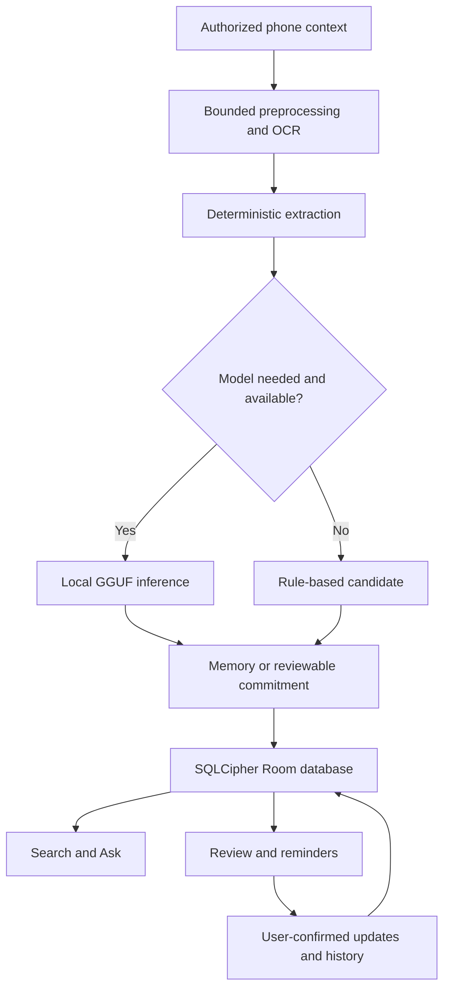

# Retenqo — Private personal intelligence

**Remember what matters. Follow through. Keep personal context local.**

Retenqo is a local-first Android AI memory and commitment assistant. It turns authorized phone context into searchable memories, source-linked answers and reviewable commitments, helping people recover important information and act on deadlines without sending their prompts or memories to a cloud AI service.

[Official website](https://retenqo.pages.dev) · [Download](https://retenqo.pages.dev/download) · [Evaluation guide](docs/EVALUATION_GUIDE.md) · [Architecture](docs/ARCHITECTURE.md) · [Verification](docs/TESTING.md)

[](LICENSE)

> **Latest stable:** [Retenqo v0.1.4 for Android 13+ (ARM64)](https://github.com/priyanshuchawda/retenqo/releases/latest). It includes the SQLCipher pooled-connection fix, verified against the pinned publisher certificate and installed as an in-place upgrade on Android 16.

## Engineering highlights

| Capability | Engineering achievement |
| --- | --- |
| Local intelligence | Quantized GGUF inference via llama.cpp; rules-first extraction and lexical retrieval |
| Contextual capture | Seven opt-in notification source groups; explicit screen and selected-media intake |
| Commitment lifecycle | Review, source evidence, reminders, completion suggestions and decision history |
| Protected persistence | SQLCipher Room database, Android Keystore-backed key protection, explicit migrations |
| Recovery | Passphrase-derived AES-256-GCM backup exports |
| Trusted distribution | Static Astro website; streamed APK digest, package identity and pinned signer verification |

## Verification at a glance

| Scope | Recorded result |
| --- | --- |
| Android [v0.1.4](https://github.com/priyanshuchawda/retenqo/releases/tag/v0.1.4) | Signed release built and verified; 114 JVM tests passed and 6/6 instrumentation tests passed on the source before the version-only bump |
| Physical-device release upgrade | Existing production installation upgraded and launched successfully on Android 16 / API 36; original first-install timestamp retained |
| Android source verification | 114/114 JVM tests passed, zero failures/errors/skips; zero Android Lint errors |
| Website unit verification | 25/25 tests passed; V8 coverage of configured library scope: 94.59% lines, 93.75% statements, 92.85% branches, 100% functions |
| Website quality | 12 static pages built; lint and type checks passed; website dependency audit reported no known vulnerabilities |
| Website browser verification | Latest recorded run: 98 passed, 2 flaky cases passed on retry, 68 skipped |
| Production Lighthouse, one mobile-simulated run | Performance 92, accessibility 100, best practices 100, SEO 100; LCP 1.263 s, CLS 0 |

These are recorded results from the 25 November verification report and published release, scoped to their tested revisions. Website coverage is not Android coverage. See [complete results, coverage and provenance](docs/TESTING.md).

## Open Innovation — Problem statement

Everyday digital context is fragmented across notifications, messages, images and documents. People lose time reconstructing important information, miss commitments buried in conversations and struggle to follow through. Existing search and task tools often require manual organization, while cloud-based AI may expose sensitive personal context or require connectivity.

**Open Innovation challenge:** Build a privacy-first, mobile personal-intelligence system that turns user-authorized context into structured, retrievable memories and reviewable commitments; supports evidence-linked recall and timely follow-through; and uses resource-aware on-device processing while preserving user consent and decision authority.

### Retenqo's solution

Retenqo connects context capture, local AI, protected memory, evidence-aware recall and commitment review into a single Android workflow. Supported platform permissions and human approval keep capture and consequential updates under user control.

| Problem | Implemented solution | Engineering evidence |
| --- | --- | --- |
| Fragmented context | Seven configurable notification groups, selected media, sharing and OCR | [Architecture](docs/ARCHITECTURE.md) |
| Forgotten information | Local structured records, lexical ranking and evidence-linked Ask | [AI implementation](docs/AI_IMPLEMENTATION.md) |
| Missed commitments | Reviewable deadlines, reminders and completion evidence | [Traceability](docs/REQUIREMENTS_TRACEABILITY.md) |
| Sensitive personal data | Local inference, SQLCipher Room and authenticated backup exports | [Security review](docs/SECURITY_REVIEW.md) |
| Mobile resource constraints | Rules-first extraction, quantized inference and bounded workloads | [Performance](docs/PERFORMANCE.md) |

This is the project's self-defined Open Innovation problem, not a quoted external challenge. See [product requirements](docs/PRODUCT_REQUIREMENTS.md) and [evaluation alignment](docs/EVALUATION_GUIDE.md).

## How it works



| Capability | Current implementation |
| --- | --- |
| Capture | Configurable notification groups, user-initiated MediaProjection, optional bounded accessibility context |
| Selected media | System picker and share targets; on-device OCR |
| Recall | Lexical ranking, evidence-linked answers and general local questions; [retrieval scope](docs/AI_IMPLEMENTATION.md) |
| Commitments | Review, accept, dismiss, edit, complete, snooze, reopen; completion suggestions |
| Reminders and widget | Local reminders and a count of confirmed follow-ups |
| Voice | Whisper bridge and Android TTS; [verification scope](docs/TESTING.md) |
| Backup | Encrypted exports and additive restore, including legacy plaintext imports |

Example: an authorized message asks for slides by Friday. Retenqo can produce a reviewable commitment, preserve its source, support a reminder and later completion review. Illustrative workflow; see [implementation status](docs/IMPLEMENTATION_STATUS.md) for device verification scope.

## Technology and design

| Layer | Technology |
| --- | --- |
| Android | Kotlin, Compose, Material 3, ViewModel, coroutines, Flow |
| Persistence | Room / SQLCipher, Android Keystore, schema migrations |
| Processing | WorkManager, deterministic extraction, ML Kit OCR |
| AI | llama.cpp, JNI, GGUF, whisper.cpp and Android TTS |
| Toolchain | Gradle Kotlin DSL, JDK 21, Android SDK 36, NDK |
| Website | Astro static output, TypeScript, Tailwind CSS v4, Zod, Vitest, Playwright |

Recommended language model: Qwen3.5-0.8B Q4_0, a separate 563,036,064-byte download. See [model setup](docs/OFFLINE_MODELS.md) and [AI implementation](docs/AI_IMPLEMENTATION.md).

## Download and installation

The latest stable binary is [v0.1.4](https://github.com/priyanshuchawda/retenqo/releases/tag/v0.1.4), version code 5, Android 13+, ARM64, 39,374,307 bytes (~37.55 MiB). [Download the signed APK](https://github.com/priyanshuchawda/retenqo/releases/download/v0.1.4/Retenqo-v0.1.4-arm64-v8a.apk). The release includes the SQLCipher pooled-connection fix and a successful in-place production upgrade on Android 16. The published SHA-256 and pinned publisher certificate are listed in [release verification](docs/TESTING.md).

Use the [download page](https://retenqo.pages.dev/download) for checksum and signer details and the [installation guide](https://retenqo.pages.dev/installation). Keep Android security protections enabled and back up personal data before updating.

## Privacy and security

Local inference does not require cloud AI endpoints. Notification capture starts paused; source groups are opt-in. The core database is encrypted at rest and new backup exports are authenticated and encrypted. Application-level encryption covers Room records and new encrypted backup exports. See the [storage and capture boundaries](docs/THREAT_MODEL.md), [security reporting policy](SECURITY.md) and [implementation status](docs/IMPLEMENTATION_STATUS.md).

## Build from source

Prerequisites: Git, Bash (Linux/WSL) or PowerShell on Windows, JDK 21, Android SDK platform 36, NDK 28.2.13676358 and CMake 4.1.2.

```bash
git clone https://github.com/priyanshuchawda/retenqo.git
cd retenqo
./scripts/build-mneme.sh
```

Windows: `./scripts/build-mneme.ps1 -Task verify` or `-Task assembleDebug -Install` with an authorized connected device. Debug and release application identities differ. See [release process](docs/RELEASE_PROCESS.md).

## Engineering documentation

| Document | Purpose |
| --- | --- |
| [Evaluation guide](docs/EVALUATION_GUIDE.md) | Six evaluation criteria and evidence |
| [Requirements traceability](docs/REQUIREMENTS_TRACEABILITY.md) | Exact implementation and test references |
| [Product requirements](docs/PRODUCT_REQUIREMENTS.md) | Acceptance criteria and feature alignment |
| [Security review](docs/SECURITY_REVIEW.md) | Security invariants and regression evidence |
| [Architecture decisions](docs/DECISIONS.md) | Design rationale and trade-offs |
| [Quality gates](docs/QUALITY_GATES.md) | Reproducible engineering acceptance criteria |
| [Architecture](docs/ARCHITECTURE.md) | Component relationships, data flow and trust boundaries |
| [AI implementation](docs/AI_IMPLEMENTATION.md) | Extraction, retrieval, inference and research |
| [Testing](docs/TESTING.md) | Revision-specific results |
| [Performance](docs/PERFORMANCE.md) | Resource bounds and recorded measurements |
| [Accessibility](docs/ACCESSIBILITY.md) | Implemented measures and verification |
| [Implementation status](docs/IMPLEMENTATION_STATUS.md) | Current capabilities and verification scope |
| [Website engineering audit](web/docs/ENGINEERING_AUDIT.md) | Distribution, browser coverage and production measurements |
| [Research index](docs/RESEARCH_INDEX.md) | Historical experiments and design evolution |
| [Changelog](CHANGELOG.md) | Releases and unreleased changes |

Source: [Android](android/mneme/), [website](web/), [build helpers](scripts/), [research artifacts](eval-results/). Contributions: [CONTRIBUTING.md](CONTRIBUTING.md). License: [Apache 2.0](LICENSE); [third-party notices](docs/THIRD_PARTY_NOTICES.md).
